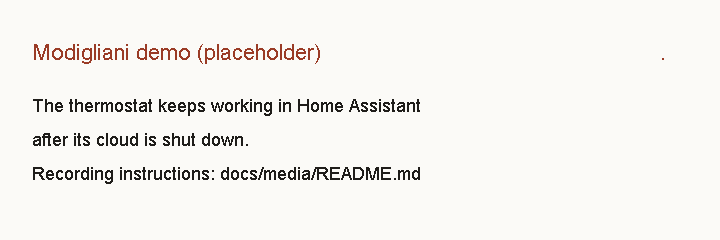
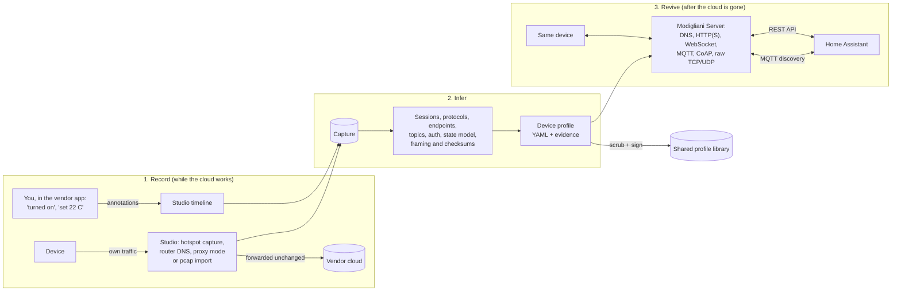

# Modigliani

**Keep your smart devices working after their company's cloud shuts down.**

[](https://github.com/ide-bloom/modigliani/actions/workflows/ci.yml)
[](https://github.com/ide-bloom/modigliani/releases)
[](LICENSE)

Modigliani records a device's traffic to its vendor's servers while they still work, works out
the protocol, and turns it into a **device profile**. The generic **Modigliani Server** then
answers the device in place of the vendor, on your own PC, Raspberry Pi or NAS, and exposes it
to **Home Assistant**. Profiles are shareable, so one person's work can revive every unit of the
same model.

> The name: Amedeo Modigliani's work found its real life only after he was gone. Modigliani gives
> devices a second life after their company's servers are gone.



*The demo GIF above is a placeholder until it is recorded; [docs/media/README.md](docs/media/README.md)
explains how to record it.*

## Why Modigliani exists

When a company shuts down its cloud, working hardware becomes e-waste overnight: thermostats,
cameras, plugs, hubs, air conditioners. Rescues so far have happened one device at a time:

- **Nest Learning Thermostats (1st/2nd generation).** The
  [No Longer Evil](https://github.com/codykociemba/NoLongerEvil-Thermostat) project reroutes the
  thermostat to a server hosting a reverse-engineered replica of the discontinued Nest API
  ([Hackaday coverage](https://hackaday.com/2025/11/11/nest-thermostat-now-100-less-evil/)).
- **BGH Smart Control air conditioners.** After the BGH cloud closed, a community member built a
  local Home Assistant integration using reverse-engineered UDP messages
  ([Home Assistant community thread](https://community.home-assistant.io/t/bgh-smart-control-is-dead-long-live-to-local-bgh-smart-control/974020)).
- **Revolv (2016).** When the Revolv hub was switched off remotely, the Home Assistant project
  argued that hubs should keep working locally after their vendor is gone
  ([Your hub should be local and open](https://www.home-assistant.io/blog/2016/04/05/your-hub-should-be-local-and-open/)).

Each rescue took deep, device-specific work. Modigliani makes the process repeatable: record,
infer, generate a profile, serve it locally, and share it.

## How it works



1. **Record.** Enroll the devices you own. Modigliani captures only their traffic, using the
   Windows Mobile Hotspot, your router's DNS, a Linux gateway, or a pcap from your router.
   Proxy mode terminates TLS with Modigliani's local CA, but only for devices that accept it.
2. **Annotate.** Each time you do something in the vendor app, type what you did in the Studio
   timeline. Those annotations tell inference which fields are commands and which are state.
3. **Infer.** `modigliani infer` reconstructs sessions and builds a profile. Each handler, state
   variable and command records the capture, flow and message index it came from.
4. **Serve.** `modigliani-server` loads profiles and answers devices: it issues tokens in the
   device's own format, records telemetry, delivers commands, answers time and firmware checks,
   and publishes Home Assistant MQTT discovery.

See [docs/architecture.md](docs/architecture.md) and [docs/inference.md](docs/inference.md).

## Install

**Studio** (Windows 11 or Linux, Python 3.12+):

```powershell
uv tool install git+https://github.com/ide-bloom/modigliani
# or download modigliani.exe from the latest release
modigliani doctor
```

**Npcap (Windows live capture only).** Download it from [npcap.com](https://npcap.com/#download)
and install it with *WinPcap API-compatible mode*. Its license forbids redistribution, so
Modigliani never bundles it. Proxy mode and pcap import work without Npcap.

**Modigliani Server**: download `modigliani-server-<os>-<arch>` from the latest release
(Windows, Linux amd64/arm64/armv7, macOS), or build the Docker image from `server/`
(`docker build -t modigliani-server server/`). The image is also published to
`ghcr.io/ide-bloom/modigliani-server` when the maintainers enable publishing. See
[docs/server.md](docs/server.md).

**Home Assistant** (pick one):

- *MQTT discovery*: point the server at your broker (`home_assistant.broker` in its config).
  You need no custom code.
- *Custom integration* (no MQTT): install `custom_components/modigliani` through HACS (custom
  repository, category *Integration*) or copy `homeassistant/custom_components/modigliani` into
  your configuration directory, then add *Modigliani* with the server URL and API token.

See [docs/home-assistant.md](docs/home-assistant.md).

## Quick start

All setups share these steps:

```powershell
modigliani ca init                         # local CA (key encrypted with DPAPI on Windows)
modigliani enroll                          # pick your device from the ARP table and confirm ownership
```

**Windows hotspot mode** (passive capture with Npcap). Turn on Mobile Hotspot, connect the
device to it, then run:

```powershell
modigliani record --mode passive --minutes 15 --name plug
modigliani annotate                        # opens the timeline; mark each action you do in the app
```

**Router mode.** Your router sends the device's DNS queries to this PC:

```powershell
modigliani record --mode proxy --dns --dns-answer 192.168.1.10 --route https:443=* --route tls:8883=*
```

Routes with hostname `*` forward each connection to the vendor host named in its TLS SNI or
HTTP `Host` header. The router-mode DNS answers only enrolled devices.

**Gateway mode.** Run Studio on the Linux box in the device's path (`--mode passive --interface eth1`).
Later, run Modigliani Server on the same box with its DNS responder enabled.

**Import.** Use a pcap from OpenWrt or tcpdump (`tcpdump -i br-lan -w device.pcap host 192.168.1.20`):

```powershell
modigliani import device.pcap
```

**Then, for every setup:**

```powershell
modigliani infer plug                      # writes profiles/local/plug.yaml and a summary
modigliani review profiles/local/plug.yaml # inspect and edit it in Studio
modigliani test profiles/local/plug.yaml   # replay the device side against the real server
modigliani-server --profiles profiles/local --config server.yaml
```

[docs/capture-setups.md](docs/capture-setups.md) has the details for each setup.

## CLI reference

| Command | What it does |
|---|---|
| `modigliani enroll [--name --mac --ip --i-own-this-device] [--list] [--remove NAME]` | Pick devices from the ARP table (nothing is scanned); you confirm you own each one. |
| `modigliani record [--mode passive\|proxy] [--minutes N] [--name] [--interface] [--route ...] [--dns ...] [--upstream-ca]` | Capture enrolled devices' traffic. Proxy mode terminates TLS only for devices that accept the local CA and forwards traffic to the real vendor. |
| `modigliani import <pcap>` | Import a pcap/pcapng, keeping only enrolled devices. |
| `modigliani annotate [capture] [--add LABEL --at TS --device NAME]` | Open the Studio timeline, or add one annotation. |
| `modigliani infer <capture...> [--device] [--id] [--name] [--vendor] [--model] [--out]` | Build a profile with evidence. |
| `modigliani review <profile> [--capture]` | Inspect and edit a profile in Studio (validated on save). |
| `modigliani test <profile> [capture...]` | Replay recorded device traffic against Modigliani Server and compare its answers. |
| `modigliani export <profile> --share [--license CC0-1.0\|CC-BY-4.0] [--author] [--yes]` | Show the full scrub diff, require confirmation, then write a scrubbed and signed profile. |
| `modigliani install <shared-profile> <capture...> [--set NAME=VALUE]` | Fill a shared profile's placeholders from your own capture. |
| `modigliani keygen` / `modigliani verify <profile>` | Create your ed25519 signing key / validate a profile and check its signature. |
| `modigliani ca init\|show` | Manage the local CA. |
| `modigliani doctor` | Check Npcap, hotspot state, DNS, the CA and server connectivity. |
| `modigliani-server --profiles <dir> --config <file>` | Run the replacement cloud. |

## Which devices can be revived

| How the device treats TLS | What Modigliani does |
|---|---|
| Plaintext (HTTP, MQTT, CoAP, raw TCP/UDP) | Fully supported. |
| Accepts a certificate from Modigliani's local CA (it does not verify certificates, or lets you set the server or CA) | Fully supported. Record in proxy mode while the cloud is alive. |
| Strictly verifies the vendor's certificate | Modigliani records metadata only (hostnames, timing, sizes) and reports **"not revivable without firmware access"**. It never tries to work around certificate verification. |

See [docs/tls-cases.md](docs/tls-cases.md).

## Sharing profiles

`modigliani export --share` replaces serial numbers, device IDs, account data, tokens, keys,
network names and addresses with placeholders. It shows you every change and asks before it
writes anything. The profile is then signed with your ed25519 key. Whoever installs the profile
fills the placeholders from their own capture (`modigliani install`). Modigliani Server verifies
signatures on shared profiles and warns about unsigned ones. Community profiles live in
[profiles/library](profiles/library) under CC0-1.0 or CC-BY-4.0, as the contributor chooses.
See [docs/scrubbing.md](docs/scrubbing.md) and [docs/profile-schema.md](docs/profile-schema.md).

## Safety and legal

- Modigliani handles only enrolled devices that you confirmed you own. It ignores other clients'
  traffic and never stores it.
- It never scans, fuzzes or sends crafted requests to vendor servers. Proxy mode forwards only
  the device's own traffic.
- The local CA key is encrypted with DPAPI on Windows and readable only by its owner elsewhere.
  It is never installed into your PC's trust store, and it is used only to answer enrolled devices.
- No firmware modification, no defeating certificate verification or pinning, no cracking of
  encryption, and no telemetry.

*Interoperability and repair rules differ by country. Check what applies where you live. This is
not legal advice.*

## Limitations

- Devices that strictly verify certificates cannot be revived without firmware access, which is
  out of scope.
- Inference works from what you record. Features you never used during recording, or that the
  cloud never sent, are not in the profile. The server records unhandled requests so you can
  record again and improve the profile.
- Binary field names come from your annotations. Unannotated fields are named `field_<offset>`,
  and constants inside binary frames are not scrubbed automatically (check them before sharing).
- HTTP/2-only and QUIC devices are not decoded yet. Some features need the vendor's own logic,
  such as cloud recordings and remote access through the vendor; Modigliani does not reproduce them.

## FAQ

**Does my device need to be online with the vendor to start?** Yes. Recording needs the cloud
to still work. After that, the profile is all you need.

**Can I use someone else's profile?** Yes, if it is for the same model. Install it with
`modigliani install` and your own short capture, so the placeholders get your device's values.

**Does Modigliani phone home?** No. There is no telemetry. Outbound traffic is only your
devices' own traffic, forwarded during recording, and the DNS lookups you ask `doctor` to make.

**Why does Home Assistant show my device as unavailable?** The server marks a device offline
when it has not been heard from within `device_timeout_s` (120 s by default).

## Roadmap

- HTTP/2 and QUIC decoding.
- A guided Studio wizard covering recording through serving.
- Profile library browsing and installation from the server's status page.
- More capture helpers for common routers.

## Contributing, security, license

- [CONTRIBUTING.md](CONTRIBUTING.md): development setup, tests and how to submit a profile.
- [SECURITY.md](SECURITY.md): how to report vulnerabilities privately.
- [CODE_OF_CONDUCT.md](CODE_OF_CONDUCT.md).
- Code: [Apache-2.0](LICENSE). Community profiles: CC0-1.0 or CC-BY-4.0, as the contributor chooses.
