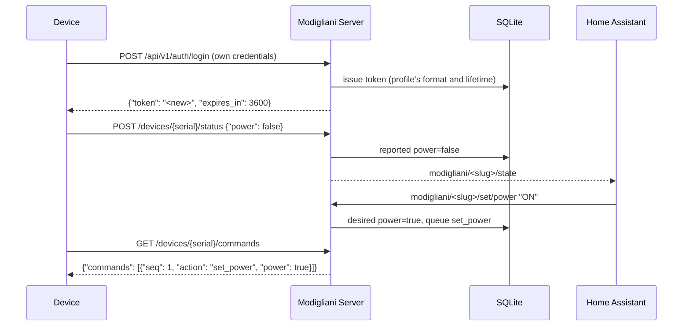

# Architecture

Modigliani has three parts. They share one contract, the device profile
([profile-schema.md](profile-schema.md)).

| Part | Language | Where |
|---|---|---|
| **Studio**: capture, annotation, inference, profiles, local UI, CLI | Python 3.12+ | `studio/src/modigliani/` |
| **Modigliani Server**: the generic replacement cloud | Go, one static binary | `server/` |
| **Home Assistant integration**: for setups without MQTT | Python (HACS) | `homeassistant/custom_components/modigliani/` |

## Studio

```
studio/src/modigliani/
  capture/     enrollment.py, hotspot.py (Npcap/libpcap live capture), dns_router.py (router-mode DNS),
               pcap_import.py (reassembly, enrollment filter), proxy.py (mitmproxy addon), model.py (capture format)
  annotate/    model.py: annotations and the free-text label parser
  infer/       decoders.py (HTTP/1.x, WebSocket, MQTT 3.1.1/5, CoAP, TLS ClientHello), sessions.py,
               templates.py, schema.py, auth.py, state.py, frames.py, values.py, engine.py
  profile/     model.py (pydantic), validate.py (JSON Schema + semantic checks), scrub.py, sign.py,
               install.py, io.py
  web/         FastAPI app and a single static page (timeline, profile editor, scrub diff)
  ca.py        local CA (RSA-2048, DPAPI on Windows, owner-only file elsewhere)
  tester.py    `modigliani test`: replay against the real server binary
  doctor.py    environment checks
  cli.py       Typer CLI
```

**The capture format.** Live capture, pcap import and proxy mode all produce the same bundle,
`captures/<name>.mcap.json`. It holds the enrolled devices, plus one entry per flow with its
endpoints, hostname, TLS outcome and timestamped byte segments in each direction. Encrypted
flows that Modigliani could not or must not read keep only metadata: segment sizes and times,
with no payload. Because decoders run on byte streams, passive and proxy captures go through the
same inference path.

**Annotations** live next to the capture in `captures/<name>.annotations.json`. Each one stores
the time, the label, the parsed value, variable hint and unit, whether it was an action or a
reading, and optionally the device it refers to.

## Modigliani Server

```
server/
  cmd/modigliani-server/   flags, config, wiring (errgroup; everything stops on SIGINT/SIGTERM)
  internal/profile/        profile types, YAML/JSON loading, template matching, ed25519 verification
  internal/engine/         devices, state, commands, token issuance, template contexts, profile loading
  internal/tmpl/           the {{ expr }} template language
  internal/frame/          binary frames: fields, length fields, checksums, stream framing
  internal/store/          SQLite (modernc.org/sqlite): devices, state, commands, tokens, counters, unhandled
  internal/ca/             loads the Studio CA; issues certificates only for profile hostnames
  internal/httpserver/     HTTP, HTTPS, WebSocket handlers
  internal/mqttserver/     embedded mochi-mqtt broker with an authentication/publish hook
  internal/coapserver/     go-coap UDP server
  internal/rawserver/      raw TCP/UDP listeners with framing
  internal/dnsserver/      miekg/dns responder for enrolled devices
  internal/api/            local REST + WebSocket API and the status page (token protected)
  internal/hass/           Home Assistant MQTT discovery publisher (paho client)
  internal/logging/        slog setup and the in-memory ring shown on the status page
```

The server is generic. Protocol handlers match incoming messages against profile handlers, take
the device identity from the message, apply *extract* rules to update reported state, and render
response templates. Commands from the API or Home Assistant become desired state, and each
profile's command transport decides how they reach the device:

- `http_poll`: queued and embedded in the next polled response;
- `mqtt`: published immediately on the device's command topic;
- `coap_response` / `raw`: carried in the next reply as `{{desired.x}}`;
- `websocket`: pushed on the open connection.

There is no global state. Components receive their dependencies explicitly and run until their
`context.Context` is cancelled.

## Data flow during revival



## Tests

- `tests/unit`: Studio unit tests (decoders, templates, schema, auth, state correlation, frames,
  profile validation, scrubbing, signatures, pcap import, CA, web UI).
- `server/internal/*/..._test.go`: every handler type, DNS, certificates, the store, the API and
  discovery payloads.
- `homeassistant/tests`: config flow, entities, the service and diagnostics, run with
  `pytest-homeassistant-custom-component`.
- `tests/e2e`: four simulated devices (`tests/devices`) and their vendor clouds
  (`tests/clouds`). The suite records them through proxy mode, infers profiles, shuts the clouds
  down, revives the devices through the server, and drives them via the API and Home Assistant
  discovery.
